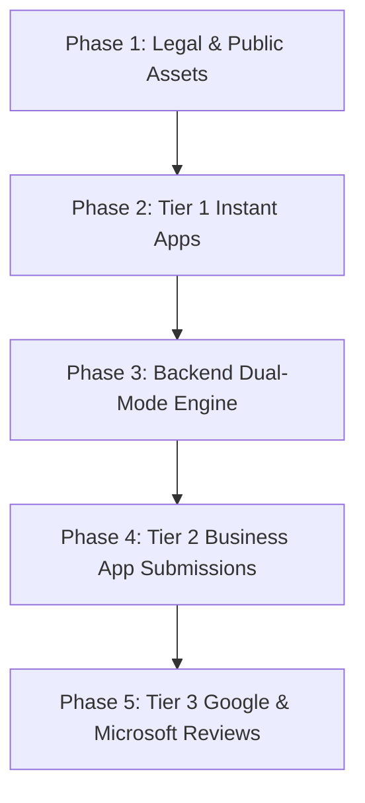

# Hosted Apps & Provider App Review Implementation Plan

**Target Architecture:** Zero-friction, 1-click authorization ("Connect with Google", "Connect with Slack", "Connect with GitHub") without requiring end-users or enterprise developers to configure GCP/developer console credentials.  
**Pattern Alignment:** Operates identically to Composio, OpenConnector, and Nango managed integrations while retaining Bring-Your-Own-Credentials (BYOC) for enterprise isolation.

---

## 1. Executive Summary & Core Concept

Currently, ConnectorHub operates in **Bring Your Own Credentials (BYOC)** mode:

- The user must register their own developer application in Google Cloud Console, GitHub Developer Settings, Slack API portal, etc.
- The user must copy/paste `client_id` and `client_secret` into ConnectorHub before connecting.

**The Hosted Model ("Managed OAuth Apps"):**

- **Embed AI / ConnectorHub maintains official, published developer apps** on major platforms.
- End-users click **"Connect with [Provider]"** and authenticate directly via OAuth in 1 click.
- ConnectorHub securely handles token exchange, refresh cycles, and API routing using managed credentials.
- **Dual-Mode Support:** Users can choose **"Use Hosted App (Recommended)"** or toggle **"Use Custom Credentials (BYOC)"**.

```
+-----------------------------------------------------------------------------------+
|                                CONNECTORHUB UI                                    |
|                                                                                   |
|  Select Authentication Method:                                                    |
|  (o) Hosted Integration (1-Click OAuth via Embed AI Managed App) [Default]        |
|  ( ) Custom OAuth App (Bring Your Own Client ID & Secret)                         |
+-----------------------------------------------------------------------------------+
           |                                                      |
           v (Hosted)                                             v (BYOC)
+---------------------------------------+      +------------------------------------+
| Embed AI Global System App Registry   |      | User-Provided Tenant Credentials   |
| (Managed Client IDs, Secrets, Scopes) |      | (Encrypted in DB per Tenant)       |
+---------------------------------------+      +------------------------------------+
                   \                                        /
                    \                                      /
                     v                                    v
           +------------------------------------------------------+
           |         Centralized OAuth Callback Dispatcher         |
           | https://connector.suparagent.ai/api/oauth/{service}/callback |
           +------------------------------------------------------+
                                     |
                                     v
           +------------------------------------------------------+
           | Secure AES-256 Storage in ConnectorHub DB (Tokens)   |
           +------------------------------------------------------+
```

---

## 2. Universal Prerequisites & Legal Checklist

Before submitting developer applications to any external provider for public review, the following company assets and infrastructure **must be live and publicly accessible**.

### 2.1 Domain & Hosting Infrastructure

- [x] **Production Domain with TLS/HTTPS (Live):** `https://connector.suparagent.ai/`
- [ ] **DNS Ownership Verification:** Ability to add DNS TXT records for domain verification (Google Search Console, Microsoft Partner Center, Meta, etc.).
- [x] **Centralized Redirect URI:** Configured callback URL registered with all providers:
  ```
  https://connector.suparagent.ai/api/oauth/{service}/callback
  ```

### 2.2 Legal & Policy Documentation

All major platforms strictly audit these pages before approving public/hosted apps:

- [ ] **Privacy Policy Page (`https://embedai.com/privacy`):**
  - **Mandatory Clauses:**
    1. **Types of data collected:** OAuth access tokens, refresh tokens, user identifiers, and provider account emails.
    2. **Purpose of data collection:** Relaying action executions initiated by the authenticated user/agent.
    3. **Data Storage & Encryption:** Explicit statement that OAuth tokens and credentials are encrypted at rest using AES-256 and in transit via TLS 1.3.
    4. **No Sale of Data:** Explicit statement that user data is never sold or shared with third-party advertisers.
    5. **Data Deletion / Revocation Policy:** Clear instructions on how users can disconnect integrations and request permanent deletion of stored credentials/tokens.
    6. **Google API Services User Data Policy Compliance:** (Specifically required by Google) Must explicitly adhere to the [Google API Services User Data Policy](https://developers.google.com/terms/api-services-user-data-policy), including the **Limited Use** requirements.

- [ ] **Terms of Service Page (`https://embedai.com/terms`):**
  - Acceptable use guidelines, SLA disclaimers, agentic automation liabilities, and termination conditions.

- [ ] **Support Channel & Landing Page:**
  - Dedicated, monitored support email: `support@embedai.com` or `integrations@embedai.com`.
  - Public integration landing page explaining the ConnectorHub product capabilities.

### 2.3 Brand & Design Assets

- [ ] **Square App Icon (128x128 PNG):** Clean, transparent background for OAuth dialog headers.
- [ ] **High-Resolution Logo (512x512 & 1024x1024 PNG/SVG):** For App Directory listings and review portals.
- [ ] **App Name Convention:** Use a consistent public name across all platforms:
  - Recommended: **"Embed AI Connect"** or **"ConnectorHub by Embed AI"**.
  - _(Note: Most platforms prohibit using their trademark in the prefix, e.g., "Google Connector" is rejected, but "ConnectorHub for Google" or "Embed AI Connect" is approved)._

---

## 3. Tiered Provider Review & Verification Deep-Dive

Platforms vary dramatically in their review stringency. We divide them into 3 distinct tiers:

```
+---------------------------------------------------------------------------------+
| TIER 1: Instant / No Approval Required (Can launch within 24 hours)             |
| GitHub, Notion, Linear, Airtable                                                |
+---------------------------------------------------------------------------------+
| TIER 2: Business & SaaS Reviews (Standard review: 2 - 5 business days)          |
| Slack, HubSpot, Atlassian (Jira/Confluence), Asana, Pipedrive                    |
+---------------------------------------------------------------------------------+
| TIER 3: Enterprise & High-Security (Strictest: 1 - 3 weeks + Video / Audit)      |
| Google Cloud (Gmail, Calendar, Drive), Microsoft Entra (Office 365, Teams)      |
+---------------------------------------------------------------------------------+
```

---

### Tier 1: Instant / Self-Serve Public (No Review Queue)

These providers do not require an upfront manual review team to enable multi-tenant public access.

#### 1. GitHub App

- **Portal:** GitHub Organization Settings -> Developer settings -> GitHub Apps -> New GitHub App.
- **Review Process:** **None required.**
- **Public Toggle:** Check **"Make this GitHub App public"** (under Advanced/Distribution). Anyone on GitHub can install it immediately.
- **Required Config:**
  - **Homepage URL:** `https://suparagent.ai`
  - **Callback URL:** `https://connector.suparagent.ai/api/oauth/github/callback`
  - **Permissions:**
    - Repository: Contents (Read & Write), Pull Requests (Read & Write), Issues (Read & Write), Commit statuses (Read & Write).
    - User: Email addresses (Read-only).
  - **Webhook:** Optional (can be disabled if only polling/initiating actions).

#### 2. Notion

- **Portal:** [Notion Developers Integrations](https://www.notion.so/my-integrations).
- **Review Process:** None for public OAuth.
- **Public Toggle:** Switch distribution type from "Internal" to **"Public"**.
- **Required Config:**
  - Company Name, Website, Privacy Policy, Terms of Service, Redirect URI.

#### 3. Linear

- **Portal:** Linear Workspace Settings -> API -> Applications.
- **Review Process:** Instant public OAuth app creation with standard scopes (`read`, `write`, `issues:create`).

#### 4. Airtable

- **Portal:** Airtable Builder Hub -> OAuth integrations -> Create new integration.
- **Review Process:** Standard scopes (`data.records:read`, `data.records:write`, `schema.bases:read`) are usable publicly without directory submission unless listing on Airtable Marketplace.

---

### Tier 2: Business Platform App Directory Reviews (2–5 Days)

#### 1. Slack (Slack App Directory)

- **Portal:** [api.slack.com/apps](https://api.slack.com/apps).
- **Approval Process:** 3 to 5 business days.
- **Key Requirements:**
  - **Granular Scopes:** Bot token scopes (`chat:write`, `channels:read`, `users:read`, `files:write`). Avoid deprecated `bot` scope.
  - **App Manifest:** Clean JSON/YAML manifest configuring commands, shortcuts, and OAuth redirect URL.
  - **Landing Page:** Must have a page explaining what the Slack integration does.
  - **Reviewer Instructions:** Provide a test Slack workspace invitation or credentials so the Slack App Review team can test the install button.
  - **Security Checklist:** Must support SSL/TLS, secure credential storage, and handle user token revocations (`tokens.revoke`).

#### 2. HubSpot (Public App)

- **Portal:** HubSpot Developer Account -> Apps.
- **Approval Process:** 2 to 4 business days.
- **Key Requirements:**
  - Developer Test Account created for the reviewer.
  - Scopes requested: `crm.objects.contacts.read`, `crm.objects.contacts.write`, `crm.objects.deals.read`, etc.
  - Install URL and redirect URI verification.

#### 3. Atlassian / Jira / Confluence (OAuth 2.0 3LO)

- **Portal:** [developer.atlassian.com/console](https://developer.atlassian.com/console).
- **Approval Process:** Automated for 3LO (3-legged OAuth) public apps; manual only if publishing to Atlassian Marketplace.
- **Required Config:**
  - Scopes: `read:jira-work`, `write:jira-work`, `read:jira-user`, `offline_access`.
  - Redirect URI: `https://api.embedai.com/api/oauth/callback`.

---

### Tier 3: High-Security Enterprise Reviews (Google & Microsoft)

#### 1. Google Cloud Platform (Google Workspace / Gmail / Calendar / Drive)

Google is the **most rigorous** app review ecosystem.

- **Portal:** Google Cloud Console -> APIs & Services -> OAuth consent screen.
- **App Status:** Set User Type to **External** and click **Publish App** (triggers review).
- **Scope Classifications:**
  1. **Non-Sensitive Scopes:** `openid`, `email`, `profile`. (Instant approval, no verification needed).
  2. **Sensitive Scopes:** Google Calendar (`calendar.events`, `calendar.readonly`), Google Sheets (`spreadsheets`). (Requires Google Trust & Safety review: ~3–7 business days).
  3. **Restricted Scopes:** Gmail (`gmail.send`, `gmail.readonly`, `gmail.modify`), Google Drive (`drive`, `drive.file`). (Requires Google Trust & Safety review + **CASA Tier 2 Security Assessment**).

- **Mandatory Google Submission Package:**
  1. **Domain Verification:** Domain verified in [Google Search Console](https://search.google.com/search-console) under the same Google account.
  2. **Written Justification per Scope:**
     - _Example for `calendar.events`:_ "ConnectorHub enables autonomous and user-scheduled agent actions to schedule meetings, update calendar invites, and read meeting schedules directly requested by the authenticated user."
  3. **Unlisted YouTube Demo Video (Strictly Required):**
     - **Duration:** 1 to 3 minutes.
     - **Must Show:**
       - The browser address bar showing the full OAuth redirect URL containing your **Google Client ID**.
       - The user clicking "Connect Google Calendar" in ConnectorHub.
       - The Google Consent screen displaying the app name and requested scopes.
       - The user approving permissions.
       - The user returning to ConnectorHub and running an action (e.g., creating a calendar event) to prove the scopes are actually used.
  4. **CASA Tier 2 (Cloud Application Security Assessment):**
     - If using _Restricted scopes_ (full Gmail/Drive), an automated vulnerability scan (OWASP ASVS / CASA) must be completed by an authorized third party (e.g., Bishop Fox, Leviathan, or automated CASA tools).
     - _Recommendation:_ Launch initial Google integration with **Google Calendar & Google Sheets (Sensitive Scopes)** first to get quick approval without the expensive CASA audit, and add Gmail Restricted scopes in Phase 2.

#### 2. Microsoft Entra ID (Microsoft 365, Teams, Outlook, Graph)

- **Portal:** Microsoft Azure Portal -> Microsoft Entra ID -> App registrations.
- **Audience:** Select **"Accounts in any organizational directory (Any Microsoft Entra ID tenant - Multitenant) and personal Microsoft accounts"**.
- **Publisher Verification Requirement:**
  - Unverified multi-tenant apps display an **"Unverified Publisher"** warning modal to enterprise users, and many corporate IT departments block them.
  - **To become a Verified Publisher:**
    1. Join the [Microsoft Partner Network (MPN)](https://partner.microsoft.com/).
    2. Provide your company's **D-U-N-S Number (Dun & Bradstreet)** to verify business registration.
    3. Link the verified MPN ID to the Azure App Registration.

---

## 4. Technical Architecture in ConnectorHub Backend

To support Hosted Apps without breaking self-hosted/BYOC instances, ConnectorHub will implement a **Managed Provider Credentials Layer**.

### 4.1 System Provider Credentials Table / Config

In addition to user connection rows in `connections`, ConnectorHub introduces system-level provider application configurations:

```python
# System-level or Managed Credentials store
class SystemProviderApp(Base):
    __tablename__ = "system_provider_apps"

    id = Column(String, primary_key=True)               # e.g., "google", "slack", "github"
    provider_id = Column(String, nullable=False, index=True)
    client_id = Column(String, nullable=False)          # Encrypted
    client_secret = Column(String, nullable=False)      # Encrypted
    default_scopes = Column(JSON, nullable=False)
    is_active = Column(Boolean, default=True)
    is_managed = Column(Boolean, default=True)           # Hosted by Embed AI
    created_at = Column(DateTime, default=datetime.utcnow)
```

Alternatively, for managed cloud deployments, these are injected via environment variables:

```bash
# Managed OAuth Provider Apps (Optional - fallback when user doesn't provide BYOC)
MANAGED_GITHUB_CLIENT_ID=gh_app_...
MANAGED_GITHUB_CLIENT_SECRET=sec_...

MANAGED_SLACK_CLIENT_ID=slack_client_...
MANAGED_SLACK_CLIENT_SECRET=slack_sec_...

MANAGED_GOOGLE_CLIENT_ID=google_client_...
MANAGED_GOOGLE_CLIENT_SECRET=google_sec_...
```

### 4.2 OAuth Resolution Priority in `oauth_service.py`

When an OAuth flow is triggered (`GET /api/oauth/{provider}/authorize`):

```python
async def get_oauth_credentials(provider_id: str, tenant_override: Optional[dict] = None):
    # 1. If tenant provided their own BYOC credentials, respect tenant override
    if tenant_override and tenant_override.get("client_id") and tenant_override.get("client_secret"):
        return {
            "client_id": tenant_override["client_id"],
            "client_secret": tenant_override["client_secret"],
            "mode": "byoc"
        }

    # 2. Otherwise, fall back to Hosted / Managed System App Credentials
    system_app = await get_system_provider_app(provider_id)
    if system_app:
        return {
            "client_id": system_app.client_id,
            "client_secret": system_app.client_secret,
            "mode": "hosted"
        }

    raise HTTPException(
        status_code=400,
        detail=f"No OAuth credentials configured for provider '{provider_id}'. Please configure custom credentials."
    )
```

### 4.3 Secure State Token Dispatch

To ensure security across multi-tenant hosted flows:

- The OAuth `state` parameter contains an HMAC-signed JWT encoding:
  - `tenant_id` / `user_id`
  - `connection_id`
  - `mode` ("hosted" vs "byoc")
  - `redirect_url`
  - CSRF nonce
- On callback, the centralized endpoint verifies the signature, exchanges the code using the matching `client_secret`, and securely encrypts the resulting access/refresh tokens in the user's connection store.

---

## 5. Step-by-Step Implementation & Submission Roadmap



### Phase 1: Foundational Assets (Week 1)

- [ ] Publish **Privacy Policy** with Google/Slack data protection & limited-use clauses.
- [ ] Publish **Terms of Service**.
- [ ] Verify domain `embedai.com` in Google Search Console and DNS.
- [ ] Prepare standard branding asset package (128x128, 512x512 logos).
- [ ] Ensure centralized redirect endpoint `https://api.embedai.com/api/oauth/callback` is live and reachable.

### Phase 2: Instant Public Providers (Week 1 - 2)

- [ ] **GitHub:** Create official GitHub App, configure scopes, enable **"Make this GitHub App public"**.
- [ ] **Notion:** Create official Notion Public Integration.
- [ ] **Linear:** Create public OAuth app.
- [ ] **Airtable:** Create public OAuth integration.

### Phase 3: ConnectorHub Dual-Mode Engine (Week 2)

- [ ] Update `server/app/services/oauth_service.py` to support fallback to managed credentials.
- [ ] Update ConnectorHub UI modal:
  - Default: **"1-Click Connect (Hosted)"** button.
  - Advanced Collapsible: **"Use Custom Client ID & Secret (BYOC)"**.
- [ ] Test end-to-end authorization and token refresh cycles with hosted GitHub and Notion apps.

### Phase 4: Business App Directory Submissions (Week 2 - 3)

- [ ] **Slack:** Submit app to Slack App Directory.
  - Prepare test workspace and reviewer walkthrough.
- [ ] **HubSpot:** Submit public app for marketplace listing.
- [ ] **Atlassian (Jira):** Configure 3LO public application.

### Phase 5: Google & Microsoft Enterprise Verification (Week 3 - 4)

- [ ] **Google Cloud:**
  - Configure OAuth Consent Screen (External).
  - Add Google Calendar & Google Sheets scopes.
  - Record unlisted YouTube demonstration video adhering to Google guidelines.
  - Submit for Google Trust & Safety verification.
- [ ] **Microsoft Entra ID:**
  - Enroll organization in Microsoft Partner Network with D-U-N-S number.
  - Complete Publisher Verification.
  - Publish multi-tenant app registration.

---

## 6. Responsibility Matrix

| Task                                                | Owner                 | Output / Deliverable              |
| --------------------------------------------------- | --------------------- | --------------------------------- |
| Privacy Policy & Terms of Service updates           | Anil / Legal          | Live URLs on `embedai.com`        |
| Domain DNS & Google Search Console verification     | DevOps / Infra        | Verified domain status            |
| Brand logo exports (128x128, 512x512)               | Design / Product      | Asset bundle (`assets/branding/`) |
| Backend Dual-Mode OAuth Engine (`oauth_service.py`) | Engineering           | Code PR with test coverage        |
| UI 1-Click Connect vs BYOC Toggle                   | Frontend              | Updated Connection Modal          |
| GitHub & Notion public app setup                    | Engineering / Anil    | Active Client IDs & Secrets       |
| Google Cloud Demo Video recording                   | Product / Engineering | Unlisted YouTube video link       |
| Google & Slack Review Submissions                   | Anil / Product        | Review tickets submitted          |

---

## 7. Next Actions to Review with Anil

1. **Production Domain (Confirmed & Active):** `https://connector.suparagent.ai/` (All callbacks resolve to `https://connector.suparagent.ai/api/oauth/{service}/callback`).
2. **App Name Branding:** Confirm public name for developer apps (e.g., `ConnectorHub by SuparAgent` or `SuparAgent Connect`).
3. **Wave 1 Providers Setup:**
   - **GitHub:** Create public GitHub App with callback `https://connector.suparagent.ai/api/oauth/github/callback`.
   - **Slack:** Create Slack app with redirect URL `https://connector.suparagent.ai/api/oauth/slack/callback`.
   - **Google Cloud:** Set OAuth redirect URI to `https://connector.suparagent.ai/api/oauth/googlecalendar/callback` (and other Google apps) and submit for sensitive scope review.
